# SpanCraft 🌉

> **Vibrant 2D Structural Physics Bridge-Building Web Game**  
> Engineered as a strict TypeScript monorepo featuring a deterministic Extended Position-Based Dynamics (XPBD) truss engine, 60 FPS layered Canvas 2D renderer, procedural Web Audio, and an OWASP-compliant Hono + SQLite WAL persistence API.

[](https://www.typescriptlang.org/)
[](https://react.dev/)
[](https://vitejs.dev/)
[](https://hono.dev/)
[](https://www.sqlite.org/)
[-729B1B?logo=vitest)](https://vitest.dev/)
[](https://vercel.com/)

---

## 🌟 Key Highlights

* **Deterministic Headless 2D XPBD Solver**: Custom-built Extended Position-Based Dynamics ($dt = 1/60\text{ s}$, 24 substeps, 2 iterations, Float64 math, compliance $\alpha = L / EA$). Member forces recovered directly via $-\lambda / h^2$ with Rayleigh damping.
* **Euler Buckling & Non-Linear Materials**: Enforces critical compressive buckling load $P_{\text{cr}} = \min(c_{\text{crush}}, \pi^2 EI / L^2)$ on wood, steel, and road members. Suspension cables follow zero-compression slack invariants ($C \le 0$).
* **Seam-Free Voronoi Wheel Contact**: Resolves tire-to-deck collisions via Single-Best Voronoi Face-Normal projection, eliminating snagging across road segment joints.
* **8-Level Escalating Campaign**: From an 8 m creek crossed by a 1.5 t hatchback to a 28 m canyon crossed by a 12.5 t 3-axle heavy freight semi. Verified solvability gates guarantee 100% flat-road collapse and engineered pass under budget caps.
* **Adaptive Engineering Hint System**: Automatically unlocks after 4 failed simulation attempts, revealing civil engineering structural diagnoses, on-canvas ghost blueprint tracing guidelines, and a one-click reference scaffold loader.
* **60 FPS Canvas / React Isolation**: Decoupled RAF loop inside `EngineController` with offscreen backdrop caching, detached 2-pass bloom buffer (zero `ctx.filter` on main canvas), and throttled HUD snapshots ($\le 12\text{ Hz}$).
* **Colorblind-Safe Visualization**: Okabe-Ito / Tol dual stress gradient with axial chevrons ($\gg$ tension, $\ll$ compression) for full accessibility.
* **Zero-Dependency Procedural Web Audio**: Real-time Paul Kellet pink-noise wind, velocity-modulated engine synth, FM stress creaks, fracture snaps, and pentatonic victory fanfares.
* **Hardened Auth & Exact Auto-Resume**: Argon2id password hashing ($m=19456, t=2, p=1$), 160-bit CSPRNG tokens with SHA-256 storage, single HttpOnly `spancraft_session` cookie, CSRF Origin validation, and seamless guest-to-account progress migration.

---

## 🏗 System Architecture & Monorepo Topology

```mermaid
flowchart TD
    subgraph Monorepo ["SpanCraft TypeScript Monorepo"]
        subgraph SHARED ["packages/shared (Zero-DOM / Pure TypeScript)"]
            SCHEMAS["Zod Contracts & Schemas\n(Blueprints, Levels, Materials, Auth)"]
            MAT["5-Material Catalog\n(Road, Reinf Road, Wood, Steel, Cable)"]
            XPBD["XPBD Physics Engine\n(24 Substeps, Float64, Euler Buckling)"]
            VORONOI["Single-Best Voronoi Contact\n(Tire Snagging Elimination)"]
            QUOT["Quotation Engine & Star Evaluator"]
            SIM["Headless SimulationRunner"]
        end

        subgraph API ["apps/api (Hono + SQLite WAL Backend)"]
            DB["SQLite Engine (WAL Mode, node:sqlite)\nPRAGMAs: busy_timeout=5000, NORMAL"]
            ARGON["Argon2id Hasher\n(m=19456, t=2, p=1)"]
            SESS["Session Store (160-bit CSPRNG,\nSHA-256 Token Storage, 30d Sliding)"]
            CSRF["CSRF Origin Middleware"]
            ROUTES["REST Endpoints\n(/api/auth, /api/progress, /api/levels)"]
        end

        subgraph WEB ["apps/web (Vite + React 19 + Canvas 2D)"]
            RENDERER["CanvasRenderer (Multi-layer)\n(Offscreen Backdrop Cache, 2-Pass Bloom)"]
            EDITOR["BlueprintEditor\n(Grid Snap, 50-Step Undo, Auto-Triangulate)"]
            AUDIO["ProceduralAudio (Zero Assets)\n(Pink Noise, Engine Synth, Stress Creak)"]
            ENGINE["EngineController\n(1/60s RAF Loop, Throttled HUD <=12Hz)"]
            STORE["useGameStore\n(Offline Guest Progress + Cloud Sync)"]
        end
    end

    SHARED --> API
    SHARED --> WEB
    API <-->|REST API / HttpOnly Cookie| WEB
```



### Dependency Decoupling Rule
* **`packages/shared`**: Zero DOM, Canvas, React, or database imports. Compiles identically in Node.js (Vitest runner), browser client (web bundle), and Hono API server (server-side replay & quotation verification).
* **`apps/api`**: Pure Node.js server powered by Hono and native `node:sqlite` (`DatabaseSync`), bypassing fragile external C++ compilation while maintaining WAL concurrency.
* **`apps/web`**: React 19 UI shell for HUD overlays and raw HTML5 Canvas 2D for 60 FPS graphics.

---

## 🎮 Campaign Levels & Solvability Gates

| Level | Name | Span | Budget | Vehicle | Weight | Engineering Challenge |
| :---: | :--- | :---: | :---: | :--- | :---: | :--- |
| **1** | Sunny Creek | 8 m | \$4,800 | Hatchback | 1.5 t | Baseline triangulation & anchor load transfer |
| **2** | Timber Gorge | 12 m | \$7,600 | Pickup Truck | 2.2 t | Top-chord Warren through-truss under tension |
| **3** | River Pier | 16 m | \$12,800 | Delivery Van | 3.5 t | Central riverbed pier with dual balanced spans |
| **4** | Stepped Bluff | 14 m | \$23,500 | Safari SUV | 2.8 t | Asymmetric gorge abutments with elevation drop |
| **5** | Barge Canal Arch | 16 m | \$28,500 | City Bus | 6.5 t | High waterway clearance & parabolic thrust arch |
| **6** | Cable Ravine | 20 m | \$35,500 | Heavy Box Truck | 8.0 t | Tall tower cable-stayed deck with tension fans |
| **7** | Twin Viaduct | 24 m | \$46,500 | Escort Sedan | 2.0 t | Multi-pier viaduct spanning deep canyon floor |
| **8** | Grand Canyon Freight | 28 m | \$72,000 | 3-Axle Heavy Semi | 12.5 t | Massive combination Pratt truss & suspension |

---

## ⌨️ Controls & Keybindings

| Action | Control | Description |
| :--- | :--- | :--- |
| **Place Member / Joint** | `Left Click + Drag` | Draw structural beams connecting grid points or anchor pins |
| **Delete Member / Joint** | `Right Click` / `Middle Click` | Erase unwanted beams or joints from the blueprint |
| **Pan Canvas** | `Right Click + Drag` | Pan CAD viewport across wide spans |
| **Zoom Viewport** | `Mouse Wheel` | Zoom in for fine joint placement; zoom out for bridge overview |
| **Test Bridge / Stop** | `Spacebar` | Toggle between CAD construction mode and live XPBD simulation |
| **Undo / Redo** | `Ctrl + Z` / `Ctrl + Y` | 50-step undo/redo history buffer |
| **Grid Snapping** | `G` | Cycle grid snap between `0.5m`, `1.0m`, and `OFF` |
| **Select Road** | `1` | Select standard road deck material |
| **Select Reinforced Road** | `2` | Select heavy-load reinforced road deck |
| **Select Wood** | `3` | Select cost-effective timber struts |
| **Select Steel** | `4` | Select high-tensile steel beams |
| **Select Cable** | `5` | Select suspension cables |

---

## 🚀 Getting Started

### Prerequisites
* **Node.js**: v22.0.0 or later (v22+ includes native `node:sqlite`)
* **npm**: v10.0.0 or later

### Installation
```bash
# Clone the repository
git clone https://github.com/<your-username>/spancraft.git
cd spancraft

# Install monorepo dependencies
npm install
```

### Development
```bash
# Start both Backend API (:8787) and Vite Frontend (:5173) concurrently:
npm run dev

# Or start services independently:
npm run dev:api   # Hono API on http://127.0.0.1:8787
npm run dev:web   # Vite dev server on http://127.0.0.1:5173
```

Open [http://127.0.0.1:5173](http://127.0.0.1:5173) in your browser.

---

## 🧪 Testing & Verification

SpanCraft enforces a mandatory verification gate covering headless XPBD physics, analytical static equilibrium, cable slack, Euler buckling, campaign solvability, and API authentication:

```bash
# Run all type checks and test suites across the monorepo:
npm run check
```

Output:
```
✓ packages/shared/src/__tests__/xpbdPhysics.test.ts (5 tests)
  - Analytical static equilibrium 2-bar 45° steel arch matches < 0.2%
  - Cable slack invariant reports exact 0.00 kN compressive force
  - Euler buckling strut passes at 1.4m and buckles at 2.4m under 60 kN
  - Voronoi contact prevents tire snagging across chained road segments
  - Deterministic simulation replay yields bit-identical coordinates & stress
✓ apps/api/src/__tests__/authProgress.test.ts (6 tests)
  - Enforces CSRF Origin protection on mutating requests
  - Registers new user with Argon2id ($argon2id$v=19$m=19456,t=2,p=1)
  - Handles login and authenticates returning players
  - Persists blueprint draft and auto-resumes returning player with exact draft intact
  - Server-side verifies level completion and unlocks next level
  - Logout deletes active session and clears cookie header
✓ packages/shared/src/__tests__/campaignGate.test.ts (16 tests)
  - Unbraced flat road collapses on all 8 levels (8/8)
  - Reference engineered bridges pass under budget with zero broken members (8/8)

Test Files:  3 passed (3)
Tests:       27 passed (27)
```

---

## 🚢 Deployment (Vercel)

SpanCraft includes a pre-configured `vercel.json` for one-click deployment:

1. Push your repository to **GitHub**:
   ```bash
   git add .
   git commit -m "feat: initial release"
   git push origin main
   ```
2. Log into [Vercel](https://vercel.com/) and click **"Add New Project"**.
3. Select your GitHub repository.
4. Vercel automatically detects the build configuration:
   * **Framework Preset**: `Vite`
   * **Build Command**: `npm run build`
   * **Output Directory**: `apps/web/dist`
5. Click **Deploy**.

> **Note on Fullstack Cloud Persistence**: When deployed to Vercel, the web game operates 100% offline in Guest Mode with full XPBD physics and local progression. If you host the Hono + SQLite backend on a persistent host (e.g., [Render](https://render.com/) or [Railway](https://railway.app/)), simply add the API domain rewrite to `vercel.json` to enable cross-device cloud profiles.

---

## 📄 License

MIT © [SpanCraft Contributors](https://github.com/)
